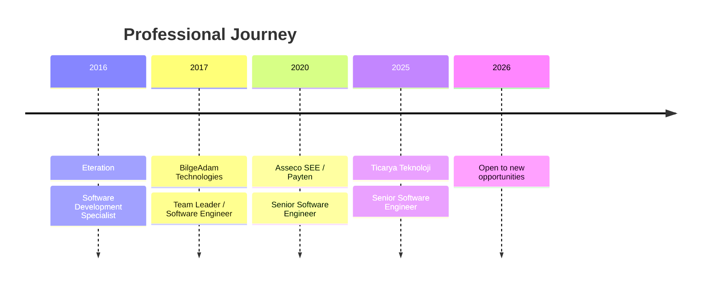

# Emre Eker

### Senior Software Engineer | Java & Spring Boot | FinTech & Payment Systems

**Enterprise Software · Distributed Systems · E-commerce · Technical Leadership**

**Open to new professional opportunities**

---

## Navigate

[About](#about-me) · [Expertise](#areas-of-expertise) · [Technology Stack](#technology-stack) · [Career](#career-timeline) · [Experience](#professional-experience) · [Project Highlights](#selected-project-highlights) · [Education](#education--certifications) · [Languages](#languages)

## About Me

I am a **Senior Software Engineer with more than 10 years of experience** designing, developing, modernizing, and supporting enterprise software. My background spans **FinTech and payment platforms, banking integrations, e-commerce systems, distributed architectures, and mobile applications**.

A significant part of my career has focused on software that supports business-critical financial operations. At **Asseco SEE / Payten**, I worked across payment products used by banks, merchants, and enterprise customers, contributing to payment capabilities, bank-specific integrations, migration solutions, and production issue resolution. I have also worked in technical leadership roles, delivered customer-facing mobile applications, and participated in enterprise modernization programs.

My primary technology ecosystem is **Java and Spring Boot**, supported by relational databases, integration technologies, messaging systems, and Linux-based application infrastructure. I am interested in building systems that are maintainable, understandable, reliable, and practical to operate.

More recently, at **Ticarya Teknoloji**, I worked on e-commerce software, payment and seller workflows, AI-assisted shopping experiences, and the infrastructure required to operate these applications.

## Areas of Expertise

| Area | Experience and focus |
| --- | --- |
| **Backend engineering** | Java applications, Spring Framework, Spring Boot, REST APIs, business logic, integrations, and persistence |
| **FinTech & payments** | Online payment platforms, card-acquiring services, merchant-facing capabilities, bank-specific payment integrations |
| **Distributed systems** | Microservices, service communication, data consistency considerations, and application integration |
| **Data & migration** | Relational database design, SQL, large-volume payment data migration, migration orchestration |
| **Software modernization** | Evolving existing Java applications and supporting enterprise application modernization initiatives |
| **Technical leadership** | Leading application development activities, coordinating technical implementation, and contributing to delivery |
| **Production operations** | Diagnosing application issues, maintaining production-facing systems, Linux, Nginx, and application runtimes |
| **AI integration** | LLM API integration, prompt/context orchestration, and AI-assisted application workflows |

## Technology Stack

<strong>Backend & API Development</strong>

 

**Technologies:** Java, Spring Boot, Spring Framework, Spring Data JPA, Hibernate, REST APIs, gRPC, SQL, JavaScript, microservices.

**Typical engineering concerns:** API contracts, persistence, integration boundaries, transaction behavior, maintainability, and production reliability.

<strong>Databases, Caching & Messaging</strong>

 

**Technologies:** PostgreSQL, Oracle Database, MySQL, Redis, Apache Kafka, RabbitMQ, Elasticsearch, Infinispan.

**Relevant experience:** Database-backed applications, enterprise integrations, and migration of large data volumes between payment environments.

<strong>Infrastructure, Delivery & Quality</strong>

 

**Technologies:** Linux/Unix, Docker, Jenkins, Git, Maven, JBoss EAP, Tomcat, Nginx, Bash, Jira, Confluence, JUnit, Mockito, SonarQube.

**Relevant experience:** Deployments, application runtime management, production troubleshooting, unit testing, and code quality tooling.

<strong>Frontend, Mobile & AI</strong>

 

**Technologies:** React, React Native, Thymeleaf, Apache Cordova, LLM API integration, prompt/context orchestration, AI-assisted workflows.

**Relevant experience:** Mobile application development, user-facing features, and AI-powered product recommendation integration.

## Career Timeline

> Dates shown in the timeline indicate the start year of each role. Full employment dates appear below.

## Professional Experience

<strong>Ticarya Teknoloji — Senior Software Engineer</strong> · Nov 2025 – Oct 2026

### E-commerce, AI Integration & Application Operations

Worked on software products spanning e-commerce, AI-powered applications, and custom enterprise solutions. The role combined application development, system design, business workflow implementation, and production infrastructure operations.

**Key contributions**

- Designed and developed application services using **Java and Spring Boot**, with REST endpoints and PostgreSQL-backed data models.
- Worked on the core e-commerce domain, including **seller operations, order lifecycle, and payment-related workflows**.
- Integrated an **AI-powered shopping assistant** designed to interpret customer requests and recommend relevant products using catalog context.
- Implemented application integration and security-oriented flows within the broader software architecture.
- Managed aspects of the **Linux-based production environment**, including Nginx configuration, deployments, monitoring, and reliability improvements.
- Participated across the software lifecycle, from application design and development through production operation.

**Domains:** E-commerce · AI integration · Backend engineering · Application infrastructure

<strong>Asseco SEE / Payten — Senior Software Engineer</strong> · Nov 2020 – Nov 2025

### Payment Platforms & Financial Integrations

Worked on large-scale FinTech software used by banks, merchants, and enterprise customers. Responsibilities covered feature development, integration work, maintenance of production-critical payment systems, platform modernization, and data migration.

**Payment platform work**

- **Paratika:** Developed and enhanced features for an online payment platform and investigated complex production issues. Worked on functionality where secure and dependable payment processing is essential.
- **NestPay:** Developed and maintained payment capabilities supporting banks that provide card-acquiring services to online merchants.
- **ZiraatPay:** Implemented payment services and bank-specific integrations for **Ziraat Bank**.
- **VakıfPay:** Implemented payment services and bank-specific integrations for **VakıfBank**.

**Migration and platform tooling**

- **Migration Tool:** Designed and developed a standalone solution to transfer **millions of records** between payment environments. This required attention to migration workflows and the handling of large volumes of payment-platform data.
- **Migration Manager:** Designed an orchestration application to coordinate migration processes and support activation of migrated merchants.
- **Routing:** Implemented functionality that dynamically directs merchants to appropriate payment environments.

**Engineering context**

The work involved a combination of feature delivery and ongoing engineering for established financial platforms. It required understanding existing systems, maintaining integrations, and addressing issues affecting production applications.

**Domains:** Payment systems · Banking integrations · Merchant services · Data migration · Platform modernization

<strong>BilgeAdam Technologies — Team Leader / Software Engineer</strong> · Dec 2017 – Sep 2020

### Technical Leadership, Mobile Applications & Modernization

Worked across client projects involving e-commerce, mobile development, enterprise platforms, and modernization of existing applications. The role included hands-on engineering and technical leadership responsibilities.

- **Decathlon Mobile Application:** Led development of a **microservice-based e-commerce application** released on both the **Apple App Store** and **Google Play**. Contributed to the delivery of a mobile product supported by backend services.
- **Mercedes Servisim:** Developed a **React Native** application supporting vehicle service tracking and customer communication.
- **HCM Platform:** Contributed to a multilingual human capital management platform, including functionality for live video calls.
- **TOFAŞ Modernization Program:** Participated in a broader initiative involving modernization of **15 applications** and led modernization work for selected Java applications.

**Domains:** Team leadership · Microservices · E-commerce · Mobile development · Enterprise modernization

<strong>Eteration — Software Development Specialist</strong> · Apr 2016 – Nov 2017

### Enterprise Web, Banking & Mobile Applications

Contributed to multiple enterprise customer projects across banking, insurance, manufacturing, logistics, and mobile software.

- **Garanti KOBİ Loyalty:** Developed **Liferay portlets** for customer loyalty services.
- **Oyak Mobile App 2.0:** Completed a substantial portion of the backend implementation for a mobile application released on major mobile platforms.
- **Erdemir Sevkiyat Online:** Contributed to an online shipment management solution.
- **Garanti Intranet:** Developed a chat module within **Garanti Bank's** intranet platform.
- **NN Senin Mobilim:** Maintained a mobile insurance application using **Apache Cordova and Java EE**.

**Domains:** Enterprise applications · Banking · Insurance · Mobile backend · Portal development

## Selected Project Highlights

The following are professional project highlights, not links to public source code.

| Project | Domain | Contribution |
| --- | --- | --- |
| **Paratika** | Online payments | Feature development and production issue resolution |
| **NestPay** | Card acquiring | Payment platform development and maintenance |
| **ZiraatPay / VakıfPay** | Banking integrations | Bank-specific payment service development |
| **Migration Tool** | Data migration | Standalone tool transferring millions of records |
| **Migration Manager** | Migration orchestration | Coordinating migrations and merchant activation |
| **Payment Routing** | Payment infrastructure | Dynamic merchant routing across environments |
| **Ticarya E-commerce** | E-commerce | Seller, order, and payment workflows |
| **AI Shopping Assistant** | Applied AI | Catalog-aware customer intent and product recommendations |
| **Decathlon Mobile** | Retail / mobile | Led development of a microservice-based mobile application |
| **TOFAŞ Modernization** | Enterprise modernization | Led selected Java modernization efforts |

## How I Approach Engineering

My work has covered both **building new applications** and **improving established enterprise systems**. These settings require different trade-offs: greenfield products need clear foundations and practical delivery, while existing payment and enterprise platforms require careful integration, maintainability, and operational awareness.

Across these environments, I focus on:

1. **Understanding the business workflow** before defining technical boundaries.
2. **Keeping backend code and integrations maintainable**, particularly in long-lived Java systems.
3. **Considering production behavior**, not just whether a feature works locally.
4. **Approaching migrations and modernization carefully**, especially when existing business processes depend on the system.
5. **Choosing pragmatic architectures** that fit the problem rather than introducing complexity for its own sake.

## Education & Certifications

**B.Sc. in Software Engineering**  
European University of Lefke — Faculty of Engineering  
**2010 – 2015**

- Academic Achievement Scholarship
- High Honour and Honour Certificates

**Certifications (2016)**

- Effective Agile Java Development
- Performance Monitoring and Tuning for Java Applications
- Agile Methodology & Scrum

## Languages

| Language | Proficiency |
| --- | --- |
| **Turkish** | Native / bilingual |
| **English** | Professional working proficiency |

---

### Let's Connect

For professional opportunities, collaboration, or technical discussions, connect with me on **[LinkedIn](https://linkedin.com/in/eeker)**.

*Senior Software Engineer · Java · Spring Boot · FinTech · Payment Systems*

