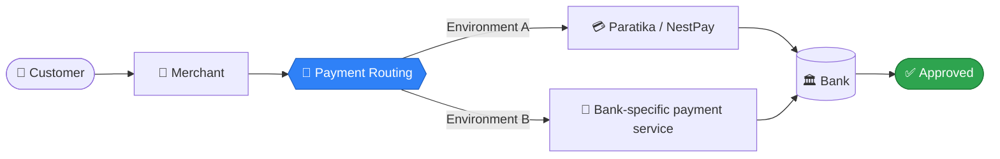
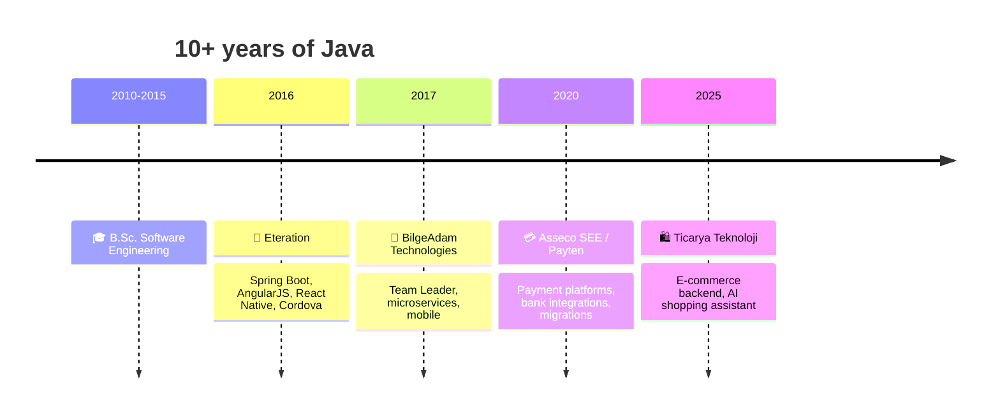

<div align="center">


<a href="https://github.com/EmreEker"></a>

<br/>

[](https://linkedin.com/in/eeker)


**[👤 About](#-about-me) · [🧰 Skills](#-tech-arsenal) · [🗺️ Journey](#%EF%B8%8F-career-journey) · [💼 Experience](#-experience-click-to-expand) · [🎓 Education](#-education--learning) · [🎮 Easter egg](#-easter-egg)**

</div>

---

## 👋 About me

```bash
$ whoami
emre-eker

$ cat profile.txt
role        : Senior Software Engineer
focus       : Backend · Java · Spring Boot · Payment Systems
experience  : 10+ years building & maintaining Java applications
superpower  : Understanding how a system works end to end
favorite    : Legacy code, tricky integrations, difficult production issues

$ echo $MOOD
"Let's debug it together" 🔍
```

I build and maintain Java applications, with much of my recent work in **payment systems**: online payment platforms, bank integrations, and tools for moving merchants and payment data between systems. I've also led development teams, contributed to mobile and e-commerce projects, and supported applications in production.

---

## 🧰 Tech arsenal

<div align="center">

### ☕ Backend


### 🗄️ Databases & Messaging


### 🛠️ Tools & Infrastructure


### 🎨 Other


</div>

---

## 💳 How a payment travels (simplified)

My day-to-day world, in one picture. Each stop on this journey is something I've built or maintained.



---

## 🗺️ Career journey



---

## 💼 Experience (click to expand)

<details open>
<summary><b>🛍️ Ticarya Teknoloji — Senior Software Engineer</b> &nbsp;·&nbsp; <i>Nov 2025 – Oct 2026</i> &nbsp;·&nbsp; Türkiye</summary>
<br/>

- 🧱 Built backend services for an e-commerce platform using **Java, Spring Boot and PostgreSQL**
- 🏷️ Worked on seller management, orders and payment-related processes
- 🤖 Integrated an **AI shopping assistant** that uses product catalog information to suggest relevant products based on customer requests
- 🖥️ Set up and maintained parts of the production environment: **Linux, Nginx** and application deployments

</details>

<details>
<summary><b>💳 Asseco SEE / Payten — Senior Software Engineer</b> &nbsp;·&nbsp; <i>Nov 2020 – Nov 2025</i> &nbsp;·&nbsp; Istanbul, Türkiye</summary>
<br/>

Payment applications used by banks and merchants: feature development, banking integrations, production investigations and internal migration tooling.

| Project | What I did |
|---|---|
| 💠 **Paratika** | Developed new features and investigated issues in an online payment platform |
| 🏦 **NestPay** | Worked on payment functionality for a platform banks use to offer online card payments to merchants |
| 🟢 **ZiraatPay & VakıfPay** | Developed payment services and integrations for Ziraat Bank and VakıfBank |
| 📦 **Migration Tool** | Designed and built a standalone tool to transfer **millions of records** between payment environments |
| 🎛️ **Migration Manager** | Built an application to coordinate migration steps and merchant activation |
| 🔀 **Payment Routing** | Developed logic for directing merchants to the appropriate payment environment |

</details>

<details>
<summary><b>👥 BilgeAdam Technologies — Team Leader / Software Engineer</b> &nbsp;·&nbsp; <i>Dec 2017 – Sep 2020</i> &nbsp;·&nbsp; Istanbul, Türkiye</summary>
<br/>

Customer projects across retail, mobile and enterprise software, combining development with team leadership.

- 🏃 **Decathlon:** Led development of a microservice-based e-commerce mobile application
- 🚗 **Mercedes Servisim:** Developed a React Native app for service tracking and customer communication
- 🌍 **HCM Platform:** Contributed to a multilingual HR application, including video calling
- 🏭 **TOFAŞ:** Worked on a program to modernize **15 applications**, leading modernization work for selected Java apps

</details>

<details>
<summary><b>🚀 Eteration — Software Development Specialist</b> &nbsp;·&nbsp; <i>Apr 2016 – Nov 2017</i> &nbsp;·&nbsp; Istanbul, Türkiye</summary>
<br/>

- 🎁 **Garanti KOBİ Loyalty:** Full-stack: Spring Boot backend services and AngularJS frontend features
- 📱 **Oyak Mobile App 2.0:** Rebuilt the mobile app from scratch: backend plus React Native frontend
- 🚢 **Erdemir Sevkiyat Online:** Online shipment management application
- 🏢 **Garanti Intranet:** Contributed to Garanti Bank's internal intranet platform
- 🛡️ **NN Senin Mobilin:** Maintained a mobile insurance app built with Apache Cordova and Java EE

</details>

---

## 🎓 Education & learning

<details>
<summary><b>📚 Click to see the details</b></summary>
<br/>

**🎓 B.Sc. in Software Engineering** — European University of Lefke (2010–2015)
🏅 Academic Achievement Scholarship · High Honour and Honour Certificates

**📜 Training & Certifications**
- Effective Agile Java Development (2016)
- Performance Monitoring and Tuning for Java Applications (2016)
- Agile Methodology & Scrum (2016)

**🗣️ Languages**
🇹🇷 Turkish: Native · 🇬🇧 English: Professional working proficiency

</details>

---

## 🎮 Easter egg

<details>
<summary><b>🥚 Guess: how many records did my Migration Tool move between payment environments?</b></summary>
<br/>

> 🎉 **Millions.** And yes, I sleep better when the row counts match on both sides. 😄

</details>

<details>
<summary><b>🐛 What's my favorite kind of bug?</b></summary>
<br/>

> The one that only happens in production, involves three systems, and has no stack trace. Challenge accepted. 🕵️

</details>

---

## 📊 GitHub stats

<div align="center">


</div>

---

<div align="center">

### 🤝 Let's connect

[](https://linkedin.com/in/eeker)

<sub>[⬆️ Back to top](#)</sub>


</div>
